# ER DIAGRAM — D1 schema (77 tables: 76 in 0001 + 1 WebAuthn table in 0004)

Full DDL: `migrations/0001_init.sql`. Mermaid rendering works in GitHub and most Markdown viewers.

```mermaid
erDiagram
  users ||--o{ user_roles : has
  roles ||--o{ role_permissions : grants
  users ||--o{ sessions : owns
  users ||--o{ devices : registers
  users ||--o{ audit_logs : writes

  product_categories ||--o{ products : classifies
  brands ||--o{ products : brands
  products ||--o{ product_batches : "FEFO batches"
  products ||--o{ product_images : "R2 keys"
  products ||--o{ stock_balance : "aggregated qty/value"
  products ||--o{ stock_movements : "every IN/OUT"
  product_batches ||--o{ stock_movements : "batch-level"
  products ||--o{ purchase_items : line
  products ||--o{ sale_items : line
  products ||--o{ stock_adjustments : delta

  parties ||--o{ party_balance : "one row"
  parties ||--o{ party_ledger : "debit/credit"
  parties ||--o{ purchases : supplies
  parties ||--o{ sales : buys
  parties ||--o{ receipts : pays
  parties ||--o{ payments : receives
  parties ||--o{ party_opening_balances : opening

  purchases ||--o{ purchase_items : contains
  purchases ||--o{ purchase_returns : reversed_by
  sales ||--o{ sale_items : contains
  sales ||--o{ sales_returns : reversed_by
  receipts ||--o{ payment_allocations : allocates
  payments ||--o{ payment_allocations : allocates

  financial_accounts ||--o{ account_balance : "one row"
  financial_accounts ||--o{ account_transactions : "IN/OUT"
  transfers ||--o{ account_transactions : "two legs"
  expenses ||--o{ account_transactions : "cash out"
  employees ||--o{ employee_advances : advance
  employees ||--o{ salary_records : monthly
  payroll_runs ||--o{ salary_records : contains

  grain_lots ||--o{ grain_weighments : "purchase/sale weighment"
  grain_weighments ||--o{ grain_deductions : "moisture/cleaning"
  grain_lots ||--o{ stock_movements : "book_code = crop"

  journal_entries ||--o{ journal_lines : "balanced (H4)"
  chart_of_accounts ||--o{ journal_lines : account_code
  documents ||--o{ journal_entries : "snapshot_json"
  stock_movements ||--o{ journal_entries : "COGS"

  daily_summary ||--o{ journal_entries : "pre-aggregated"
  sync_operations ||--o{ sync_conflicts : "flagged conflict"
  backup_logs ||--o{ job_runs : "nightly cron"
  website_enquiries ||--o{ website_enquiry_items : contains
  website_enquiries ||--o{ quotations : converts
  business_settings ||--o{ invoice_sequences : numbering
```

## Invariants enforced

1. `journal_entries` + `journal_lines`: `SUM(debit_paisa) = SUM(credit_paisa)` per entry — checked in `packages/shared/src/recipes.ts` (`assertBalanced`) and by `/api/v1/integrity/run` (nightly cron).
2. `stock_balance` is a pre-aggregated mirror of `stock_movements`; the integrity job compares them.
3. `account_balance` mirrors `account_transactions`; `party_balance` mirrors `party_ledger`.
4. Every posting is **one `db.batch()`**, with a unique `idempotency_key` recorded in `sync_operations`.
5. Posted rows are never `UPDATE`d/deleted: reversals insert new rows with `reason`, `user`, `created_at`.
6. All money columns are `INTEGER` paisa; all quantity columns are `INTEGER` milli-units; grain grams are the same integer as milli-kg.
7. `products` has **zero rows** in `0002_system_seed.sql`; `setup_complete=false`, `maund_kg=null`.
